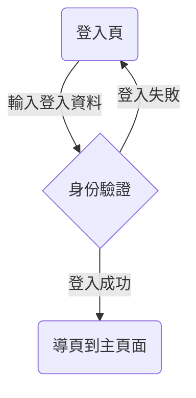

# 登入頁 HTML 雛型

- 交付可直接用瀏覽器開啟的 `login.html`，不需安裝套件。
- 包含使用者帳號輸入框、OTP 驗證碼輸入框，以及「登入驗證」與「重新傳送驗證碼」兩個按鈕。
- 僅製作前端雛型，不串接後端、不實際驗證登入或寄送驗證碼。
- 不儲存或傳送輸入資料；操作後顯示雛型提示。
- 帳號暫不限制格式，OTP 位數與格式待串接時決定。
- 欄位必填；支援鍵盤操作。

